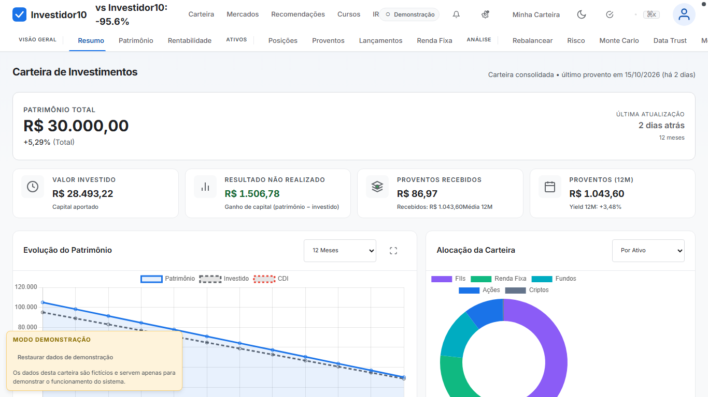

# Investidor10 Dashboard

Dashboard de carteira de investimentos estilo **Investidor10** com dados reais, rebalanceamento otimizado, análises de risco quantitativas e central de impostos (IRPF).



---

## 🚀 Features Principais

### 📊 **12 Abas de Análise**
| Aba | Descrição |
|-----|-----------|
| **Resumo** | KPIs patrimoniais, alocação, rentabilidade, proventos 12m |
| **Posições** | Tabela detalhada de ativos com P/L, dividend yield, alocação |
| **Proventos** | Histórico de dividendos/JCP/amortizações com filtros |
| **Patrimônio** | Evolução temporal com Chart.js (área/linha) |
| **Rentabilidade** | TWR/XIRR, benchmarks, rolling metrics |
| **Lançamentos** | CRUD de operações (compra/venda/aporte) |
| **Rebalancear** | Simulador de aporte + **Solver de otimização** (JS puro) |
| **Renda Fixa** | KPIs por indexador, cards CDB/CRA/DEB/LIG, confiança RF |
| **Risco** | **VaR/CVaR 95/99%, Sharpe, Sortino, Calmar, Max DD, Beta, Correlation Matrix** |
| **Monte Carlo** | **10.000+ simulações, cone P10/P50/P90, probabilidade de perda/dobrar/10x** |
| **Benchmarks** | **CDI, IBOV, IFIX, SMLL, IDIV, IMAB, BTC, DOL, USD/BRL** (brapi.dev) |
| **Impostos** | **DARF mensal, GCAP, Carnê-Leão, XML IRPF pré-preenchido** |

---

### ⚙️ **Engines Avançados (JS Puro, Zero Dependencies)**

| Engine | Arquivo | Capacidades |
|--------|---------|-------------|
| **ReturnEngine** | `advanced-engine.js` | TWR (daily snapshots), XIRR (Newton-Raphson), readiness states |
| **SnapshotManager** | `advanced-engine.js` | Hash determinístico, retenção 365d, auto-daily, estados build |
| **RFConfidence** | `advanced-engine.js` | 5 níveis: SUPPORTED/SHADOW/MANUAL/STALE/UNKNOWN |
| **ImportPipeline** | `advanced-engine.js` | 12 passos atômicos: DETECT→PARSE→NORMALIZE→CLASSIFY→FINGERPRINT→ASSET_RESOLUTION→DEDUP→RECONCILIATION→PREVIEW→BLOCKERS→CONFIRM→WRITE |
| **DataStates** | `advanced-engine.js` | 7 estados: AVAILABLE/PARTIAL/UNAVAILABLE/TRACKING_STARTED/STALE/LOADING/ERROR |
| **RebalanceEngine** | `rebalance-engine.js` | Solver com restrições: lote mínimo, max 20% ativo, max 40% setor, taxa corretagem |
| **RiskEngine** | `risk-engine.js` | VaR histórico/paramétrico, Sharpe/Sortino/Calmar, Max DD, Beta, Rolling 63d, Correlation Matrix |
| **BenchmarkEngine** | `benchmark-engine.js` | 9 benchmarks reais via brapi.dev + mock fallback, comparação portfolio |
| **MonteCarloEngine** | `monte-carlo-engine.js` | GBM, inflação, aporte crescente, percentis, chart interativo |
| **TaxEngine** | `tax-engine.js` | IRPF 2024/25: DARF, GCAP, isenções, day trade, FII, XML declaração |

---

### 🛡️ **Segurança & Qualidade**

- **CSP Headers** completos via `serve.py`
- **Security Headers**: `X-Content-Type-Options`, `X-Frame-Options`, `Referrer-Policy`, `Permissions-Policy`, `COOP`, `CORP`
- **Upload Validation**: ≤5MB, apenas `.json`/`.csv`, sanitização filename
- **Acessibilidade WCAG 2.1 AA**: axe-core critical=0, focus-visible, touch targets ≥44px, semantic headings, chart alt text, aria-live, prefers-reduced-motion
- **Testes E2E**: 41 testes Playwright (desktop 1366x768, mobile 390x844, tablet 768x900)

---

### 📱 **PWA Ready**

- `manifest.json` instalável
- `sw.js` Service Worker (cache-first static, network-first API)
- Offline-capable
- `robots.txt` para privacidade

---

## 🏗️ Arquitetura

```
investidor10-dashboard/
├── index.html                    # Single-page app, 12 tabs
├── script.js                     # Core ES6 module (UI, charts, state)
├── real-mode.js                  # Data integration, engines init, 12 panels
├── advanced-engine.js            # ReturnEngine, SnapshotManager, RFConfidence, ImportPipeline, DataStates, A11y
├── rebalance-engine.js           # RebalanceEngine (solver JS)
├── risk-engine.js                # RiskEngine (VaR, Greeks, Correlation)
├── benchmark-engine.js           # BenchmarkEngine (9 indices)
├── monte-carlo-engine.js         # MonteCarloEngine (GBM, 10k paths)
├── tax-engine.js                 # TaxEngine (IRPF, DARF, GCAP, XML)
├── carteira-data.js              # Dados reais (40 ativos, 72 tx, 435 prov, 4 metas)
├── serve.py                      # HTTP server with CSP/Security headers
├── sw.js                         # Service Worker PWA
├── manifest.json                 # PWA manifest
├── robots.txt                    # Privacy
├── .github/workflows/ci.yml      # CI/CD: lint + Playwright + axe + security check
├── tests/e2e/
│   ├── smoke.spec.js             # 6 tests
│   ├── tabs.spec.js              # 16 tests
│   ├── import.spec.js            # 5 tests
│   └── a11y.spec.js              # 14 tests
├── .github/scripts/check_security_headers.py
├── docs/
│   ├── plans/                    # Planos de execução
│   └── preview.png
├── MODEL_SELECTION_GUIDE.md      # NVIDIA NIM selection
├── SKILLS_PLAYBOOK.md            # Skills workflow
├── AGENT_USAGE_GUIDE.md          # Agent usage rules
├── MODEL_FALLBACK_FRAMEWORK.md   # Auto model fallback on 429
└── README.md                     # This file
```

---

## ⚡ Quick Start

### 1. Clone & Install
```bash
cd investidor10-dashboard
# Nenhum build step necessário - vanilla HTML/CSS/JS
```

### 2. Run Local Server (Secure)
```bash
python serve.py
# Server: http://localhost:8765
# Abra http://localhost:8765/index.html no navegador
```

### 3. Alternative (Simple HTTP)
```bash
python -m http.server 8000
# http://localhost:8000/index.html
```

---

## 📦 Dados Suportados

| Fonte | Formato | Processamento |
|-------|---------|---------------|
| Backup Investidor10 | `.json` | Drag & drop → ImportPipeline (12 steps) |
| Posição B3 | `.xlsx` | Parse → Reconciliação automática |
| Proventos B3 | `.xlsx` | 340+ linhas, preço unitário, tipo |
| Posição Detalhada | `.xlsx` | 3 abas: Posição, Rendimentos, Resumo |
| Extratos PDF | `.pdf` | pdfplumber → extração CDB/CRA/DEB/LIG |

---

## 🧪 Testes

```bash
# Instala Playwright (primeira vez)
npx playwright install

# Roda todos os testes (desktop + mobile + tablet)
npx playwright test

# Apenas desktop
npx playwright test --project=desktop

# Apenas mobile
npx playwright test --project=mobile

# Apenas tablet
npx playwright test --project=tablet

# Ver relatório HTML
npx playwright show-report
```

**Resultados atuais:** 41/41 passing (Desktop ✅, Mobile ✅, Tablet ✅)

---

## 🔐 Segurança

O servidor `serve.py` implementa:

```python
# CSP Example
Content-Security-Policy: 
  default-src 'self'; 
  script-src 'self' 'unsafe-inline' https://cdn.jsdelivr.net; 
  style-src 'self' 'unsafe-inline' https://fonts.googleapis.com; 
  font-src 'self' https://fonts.gstatic.com; 
  connect-src 'self' https://brapi.dev https://api.awesomeapi.com.br; 
  frame-ancestors 'none'; 
  base-uri 'self'; 
  form-action 'self'

# Security Headers
X-Content-Type-Options: nosniff
X-Frame-Options: DENY
Referrer-Policy: strict-origin-when-cross-origin
Permissions-Policy: camera=(), microphone=(), geolocation=()
Cross-Origin-Opener-Policy: same-origin
Cross-Origin-Resource-Policy: same-origin
```

---

## 🤖 Agentes NVIDIA NIM (Model Selection)

Consulte `MODEL_SELECTION_GUIDE.md` e `AGENT_USAGE_GUIDE.md`.

| Tarefa | Modelo Recomendado |
|--------|-------------------|
| General coding | `nemotron-3-ultra-550b-a55b` |
| YAML/CI/CD | `nemotron-3-super-120b-a12b` |
| Long context (>100k) | `deepseek-v4-pro-0813` |
| Tool calling | `mistral-nemotron` |
| PDF parsing | `nemotron-parse` |
| Optimization | `cuopt` |
| **Rate limit fallback** | `nemotron-3-nano-30b-a3b` |

**Auto-fallback framework:** `MODEL_FALLBACK_FRAMEWORK.md`

---

## 📋 Governança de Dados (Princípios)

> **UNKNOWN ≠ ZERO** • **PARTIAL ≠ COMPLETE** • **STALE ≠ FRESH** • **ENGINE ≠ DATA_READY**

- **Nunca inventar** preços, histórico, benchmark, dividendos, rentabilidade
- **Pipeline obrigatório**: FILE → DETECT → PARSE → NORMALIZE → VALIDATE → PREVIEW → DEDUP → CONFIRM → WRITE
- **Preview = obrigatório**, writes = 0 antes da confirmação
- **Snapshots determinísticos** com hash de conteúdo
- **Confidence scoring** para RF (5 níveis)
- **Acessibilidade**: axe critical=0

---

## 📁 Backup & Persistência

```bash
# Backup automático para Google Drive
cp -r . "/mnt/g/Meu Drive/Codex/investidor10-dashboard/"

# Ou use o script
./docs/plans/2026-09-27-execucao-noturna.sh
```

---

## 🛠️ Desenvolvimento

### Estrutura de Dados Principal (`carteira-data.js`)
```javascript
window.CARTEIRA_DATA = {
  meta: { source, version, generatedAt, accounts },
  assets: [...],           // 40 ativos com preço, classe, setor
  positions: [...],        // Posição atual B3 reconciliada
  entries: [...],          // 72 transações históricas
  earnings: [...],         // 435 proventos (set/25-set/26)
  fixedIncome: [...],      // 5 títulos + 90+ CDBs
  goals: { allocation: {...}, targetValue: ... },
  reconciliation: { b3Total, backupTotal, gaps: [...] }
};
```

### Adicionando Nova Aba
1. Adicione `<button class="tab-btn" data-tab="nova">Nova</button>` no header
2. Adicione `<section role="tabpanel" id="panel-nova" hidden>...</section>` no main
3. Adicione init em `real-mode.js`: `initNovaPanel()`
4. Registre em `TABS` array nos testes

---

## 📄 Licença

Projeto pessoal - uso educacional e privado.

---

## 🙏 Créditos

- **Chart.js** - Gráficos
- **brapi.dev** - Dados de mercado brasileiros
- **awesomeapi.com.br** - Câmbio USD/BRL
- **axe-core** - Testes de acessibilidade
- **Playwright** - E2E testing
- **NVIDIA NIM** - Modelos de IA

---

**Desenvolvido com** ❤️ **usando vanilla HTML/CSS/JS - zero build, zero dependencies, full control.**