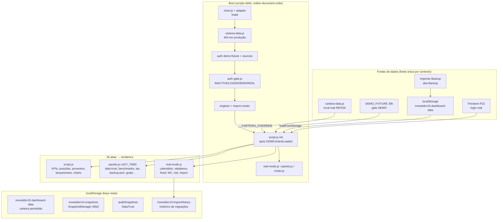

# Arquitetura — Investidor10 Dashboard

## Módulos

| Arquivo | Papel |
|---|---|
| `script.js` | Core: MOCK_DATA interno, state, renderers primários, charts, paleta ⌘K, modal, PWA |
| `real-mode.js` | Features progressivas: calendário de proventos, import center UI, rebalance, MC/risk panels, live prices |
| `panels.js` | Lazy-render das abas secundárias (LAZY_TABS), DATA() = fonte única de leitura |
| `router.js` | Hash SPA: `#/tab?ticker=X` → filtro + highlight + scroll |
| `advanced-engine.js` | ReturnEngine (TWR/XIRR), SnapshotManager, RFConfidence, DataStates, A11y |
| `data-trust-engine.js` | Auditoria de qualidade → alertas por severidade |
| `src/auth/` | Gate P22 (auth-gate), fixture demo, sources (local-demo, firestore-real) |
| `src/import-center/` | Parsers B3/Inter/CSV, detectors, normalizer, validator, deduper, writer |
| `src/backup-portability/` | Export JSON/CSV/Excel + import de backup + durability (quarentena/restore) |
| `src/rebalance/`, `src/montecarlo/`, `src/data-trust/`, `src/corporate-events/` | Engines modulares (referência; a versão raiz é a carregada — cuidado com conflito de `window.*`) |
| `mc-worker.js` | Web Worker do Monte Carlo (importScripts; `var window = self` antes) |
| `serve.py` | ThreadingHTTPServer local: CSP, headers, upload ≤5MB |
| `scripts/build-dist.py` | Build de produção: allowlist + terser/cleancss + sanity de privacidade |
| `sw.js` | PWA network-first nos críticos; bump de CACHE_NAME a cada release |

## Fluxos críticos

- **Boot**: defer em ordem → gate resolve → init() aplica `__CARTEIRA_OVERRIDE` (real) OU
  `loadFromStorage()` (import) OU fixture (demo). Um único escritor por render.
- **Import**: FILE → DETECT → PARSE → NORMALIZE → VALIDATE → PREVIEW (com dedup explícito
  por chave econômica `date|ticker|type|valor`) → CONFIRM → DEDUP → WRITE + snapshot
  pré/pós + histórico (`investidor10:importHistory`).
- **Backup**: export JSON v2 completo; import aplica override + MOCK_DATA + persiste na
  chave que `loadFromStorage()` lê (seções completas: patrimony/allocation/monthly).
- **Produção**: github.io = lock→demo 30k (P26/P27); `*.vercel.app` = gate INACTIVE
  (Vercel Authentication cobre deployment URLs; alias público serve só sintético).
